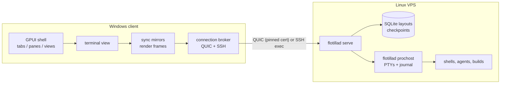

# Flotilla

A native Windows client for persistent remote agent workspaces on a Linux VPS.
The client is a view: durable terminal state, layout and processes live in a
daemon on the server, so closing the laptop, losing the network or restarting
the client never ends a running agent or its shell.

## Status

| Milestone | Scope | State |
|---|---|---|
| M0 | SSH + QUIC transports, bootstrap/upgrade, host registry, frameless client shell, nightly Windows release | released |
| M1 | Durable PTYs, exact terminal checkpoints, reconnecting sync, native terminal surface, tabs/panes/views, predictive echo | implemented, pending installed-Windows acceptance against the VPS |
| M2+ | worktrees, agent processes, files, search, ports | planned |

M1 known limits are recorded at the end of
[`docs/superpowers/plans/2026-11-02-flotilla-m1-terminals.md`](docs/superpowers/plans/2026-11-02-flotilla-m1-terminals.md):
no divider drag or tab drag-and-drop, no saved-layout launcher, no OSC52
clipboard consent flow, no bell/title/cwd notifications on the terminal wire,
and OS power-resume notifications are not wired (window activation retries
immediately instead).

## Install

Windows: run `Flotilla-Setup-x64.exe` from the
[nightly release](https://github.com/The-Coaxys/flotilla/releases/tag/nightly).
The installer is per-user, needs no administrator rights, and the executable
is statically linked against the C runtime, so no redistributable is required.

Server (Linux x86_64 or aarch64, glibc-free musl build):

```sh
install -m755 flotillad-x86_64 /usr/local/bin/flotillad
flotillad install-service                # per-user service, enabled at boot
flotillad enroll --device-name laptop   # prints device credentials as JSON
```

`flotillad install-service` writes a user unit running `flotillad serve`, which
listens on a Unix socket for the SSH transport and on UDP 7443 for QUIC. The
client tries QUIC first and falls back to SSH when the daemon, the network or
the firewall only permits one of them.

## What M1 delivers

- **Exact resume.** The daemon keeps one authoritative terminal engine per
  terminal: a content-addressed checkpoint plus a durable journal of the
  unacknowledged output suffix. Restarting the daemon or the client restores
  the same screen, scrollback, parser state (mid-UTF-8 and mid-escape
  included), title, cwd and prompt marks — not a replay of a log.
- **Processes that outlive the UI.** `flotillad prochost` owns the PTYs in a
  separate process, so an agent, `vim` or a long build keeps running across
  daemon restarts, client crashes and disconnects; their PIDs stay the same.
- **Lossless under load.** Output beyond the hot ring is journaled with a
  durable quota; at the limit the PTY is back-pressured instead of dropping
  bytes. Slow subscribers get a snapshot rather than an unbounded backlog.
- **Reconnecting sync.** RPCs and terminal records are multiplexed over one
  authenticated link, generation-tagged; a link failure discards and
  re-installs state without duplicate or lost output. Input is retried from the
  daemon's committed prefix inside a five-second deadline and never applied
  twice.
- **Native terminal surface.** GPU-rendered cells in GPUI, wide and combining
  glyphs, IME preedit, selection across soft wraps, scrollback search, links,
  mouse reporting, OSC 8, bracketed paste and terminal-first Ctrl+letter
  routing.
- **Tabs, panes and views.** The layout (view splits → ordered tabs → pane
  splits) is daemon state: every client sees the same workspace and layout
  changes apply atomically with revision checks. Divider ratios, pinning and
  ordering survive restarts.
- **Predictive echo.** Typed text is painted dimmed until the daemon's echo
  arrives; predictions are refused for full-screen programs, password prompts
  (canonical echo off) and stale mirrors, and any contradicting cell rolls the
  whole overlay back.

## Architecture



Crates: `fl-proto` (wire protocol 0.2), `fl-model` (typed layout and terminal
model), `fl-term` (pinned Alacritty/VTE forks with complete checkpoints),
`fl-transport` (framed streams, pinned-cert QUIC, SSH), `fld-server` (daemon),
`fld-prochost` (PTY owner + journal), `fld-store` (SQLite + checkpoints),
`flc-conn`, `flc-sync`, `flc-terminal`, `flc-shell`, `flc-ui`, and the
`flotilla` application.

## Development

```sh
cargo test --locked --workspace --exclude flc-ui --exclude flc-terminal --exclude flc-shell --exclude flotilla
cargo test --locked -p flc-ui -p flc-terminal -p flc-shell -p flotilla
cargo clippy --locked --workspace --all-targets -- -D warnings
cargo fmt --check
```

The GPUI crates are excluded from the default members: Linux CI type-checks
them headless (`--no-default-features`), and the real build, self-test,
installer and UI smoke run on `windows-latest`. The Rust toolchain is pinned in
`rust-toolchain.toml`; the vendored parser crates are patched in `vendor/` and
excluded from formatting.

## Licenses

Flotilla is Apache-2.0. Third-party notices and font licenses are installed
next to the application (`licenses/`) and published as
`flotilla-windows-licenses.zip` with every release.
