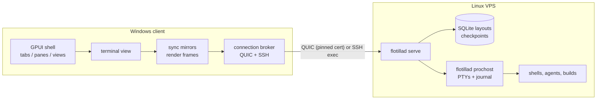

# Flotilla

A native Windows client for persistent remote agent workspaces on a Linux VPS.
The client is a view: durable terminal state, layout and processes live in a
daemon on the server, so closing the laptop, losing the network or restarting
the client never ends a running agent or its shell.

## Status

| Milestone | Scope | State |
|---|---|---|
| M0 | SSH + QUIC transports, bootstrap/upgrade, host registry, frameless client shell, nightly Windows release | released |
| M1 | Durable PTYs, exact terminal checkpoints, reconnecting sync, native terminal surface, tabs/panes/views, predictive echo | released (v0.2.0) |
| M2 | Projects and worktrees, live git status, file tree and editor, Changes diff view, setup/run scripts | released (v0.3.0) |
| M3 | GitHub integration, adaptive Git actions, sections, app-managed review threads, routed actions | in progress |
| M4 | Chat service, Claude and Codex adapters, chat surface, approvals, inbox | in progress |
| M5–M7 | More adapters, orchestration and `fl`, polish | planned |

M1 known limits are recorded at the end of
[`docs/superpowers/plans/2026-11-02-flotilla-m1-terminals.md`](docs/superpowers/plans/2026-11-02-flotilla-m1-terminals.md):
no divider drag or tab drag-and-drop, no saved-layout launcher, OSC 52
clipboard reads are never answered (only stores, with consent), and OS
power-resume notifications are not wired (window activation retries
immediately instead).

## Install

Windows: run `Flotilla-Setup-x64.exe` from the
[v0.2.0 release](https://github.com/The-Coaxys/flotilla/releases/tag/v0.2.0).
The installer is per-user, needs no administrator rights, and the executable
is statically linked against the C runtime, so no redistributable is required.

Server (Linux x86_64 or aarch64, glibc-free musl build):

The client installs the daemon over SSH when you add a host. To install it by
hand, place it where the service and the SSH transport expect it:

```sh
install -Dm755 flotillad-x86_64-unknown-linux-musl ~/.flotilla/bin/flotillad
~/.flotilla/bin/flotillad install-service                # per-user service, enabled at boot
~/.flotilla/bin/flotillad enroll --device-name laptop   # prints device credentials as JSON
```

`flotillad install-service` runs only the installed binary
(`$FLOTILLA_HOME/bin/flotillad`, default `~/.flotilla/bin/flotillad`) and
writes a user unit running `flotillad serve`, which listens on a Unix socket
for the SSH transport and on UDP 7443 for QUIC. The client races QUIC and SSH
and keeps whichever connects first; on an SSH link it re-probes QUIC every
30 seconds and moves over when UDP gets through.

## What M4 delivers

- **A native chat surface, not a terminal wrapper.** Markdown, code blocks,
  thinking, tool calls, file edits, approvals, questions, subagent children and
  turn metadata, each as its own row, rendered from the daemon's durable event
  stream and searchable read-only.
- **Send, steer, stop.** Enter sends to an idle session and steers a live turn,
  Shift+Enter adds a line, and Stop is an explicit RPC. A failed or closed turn
  stays visible until the next message.
- **Approvals and questions are cards, not prompts.** The provider's offered
  decisions become buttons; duplicates in flight are blocked, and resolution
  comes from durable `RequestResolved` events, so a reconnect or redraw can
  never answer on your behalf.
- **Inbox and in-app notifications.** Session lists, unread inbox items and
  toasts (plus an inbox panel) are derived from the live event stream; opening
  an item navigates to the exact session and the daemon's records, not UI
  memory.
- **Provider setup on the spot.** Discovery reports version and capabilities
  per provider; model, thinking and permission mode are chosen before the
  session starts and are stored with it.

## What M5 delivers

- **More providers behind one model.** Claude Code (`stream-json`), Codex
  (`app-server`), Cursor (`cursor-agent`), Pi and Oh My Pi (`--mode rpc`) are
  built in, and any ACP v1 agent (OpenCode, Hermes, ...) can be configured with
  a command and arguments.
- **Honest discovery.** Each provider is probed for its version, help text and
  handshake; a missing or unsupported CLI becomes an unavailable reason, never
  a fake capability. Capabilities (resume, steer, approvals, questions,
  partial messages) are per provider.
- **Same guarantees everywhere.** Every adapter is bounded in line and text
  size, validates resume targets, never auto-approves, refuses read-only mode
  where the CLI cannot enforce it, and finalizes the turn on child death or
  protocol errors.

## What M6 delivers

- **`fl`, a scriptable client for the same daemon.** Status, workspaces,
  sections, worktree state and checks, review threads, project scripts, tabs,
  layouts, chats, history, agents, team runs, coordination state and hooks,
  all with `--json` and daemon error codes as exit statuses.
- **Roots in your shell.** Caller resolution uses `FLOTILLA_SESSION_ID` and the
  canonical cwd; `--worktree` accepts an id, a label or a path. Mutating
  commands prove the durable effect rather than the printed line.
- **Teams that meet in one place.** `fl team run --file team.json` launches
  1–8 role chats, each in its own named tab of the target worktree, each with
  its label, run id and report contract. Only structured adapter events move a
  role; the lead receives exactly one short fan-in when every role settles.
  Runs, roles and reported summaries are durable, so `team status`,
  `team report` and `team list` keep working after a daemon restart. Provider
  processes are daemon-owned and are not reattached, so a restarted run shows
  its last durable state.
- **Coordination instead of guesswork.** `fl coordination-state` keeps
  per-worktree, per-workspace or global values with a monotonic version,
  compare-and-set (`--if-version`, 0 creates only), delete, and `watch` that
  prints every new version. Advisory `lock`/`unlock` carries an owner and a TTL;
  a stale version or a held lock exits non-zero with the daemon's reason.
- **Guides and hooks in the binary.** `fl instructions
  [orchestration|layout|worktree|review|browser]` prints Flotilla-authored
  guides that ship with `fl` and work without a daemon. Provider hooks call
  `fl hook <event>`; tool start/end become tool rows and turn start/end moves
  the status with source `Hook`, while hooks can never approve, answer a
  question, or invent a turn outcome.
- **Refusals instead of guesses.** Terminal-only agent delivery, queued chat
  while a turn is live, stale compare-and-set writes, held locks, malformed
  team files and unknown targets fail with a clear reason.

## What M3 delivers

- **The whole review loop from the bottom bar.** Commit (dialog or all
  changes), push, open a pull request, mark it ready, merge with the method the
  repository allows, then delete the merged worktree. The adaptive button shows
  the one next step for the current state and a dropdown lists the rest.
- **A forge that uses the server's own sign-in.** GitHub through `gh`: the
  branch's pull request, mergeability, review decision, unresolved threads and
  every check (paginated), with polling that backs off on rate limits. A
  missing or signed-out `gh` is reported as an unavailable reason, never an
  error.
- **Checks and reviews.** A Checks tab with links and statuses, and
  app-managed review threads anchored to a file or a line range, with replies,
  Should fix / Dismiss, lifecycle states and a pending bundle you can copy or
  dispatch to an agent.
- **Sections.** Manual and filter sections (pull request state, review
  decision, checks, agent state, run state, branch glob) with display order,
  filter priority, pins and manual assignments; pins win, then manual
  assignment, then the first matching filter.
- **Fast/Thorough routes.** Per-scope provider, profile, model, thinking and
  prompt templates (global, workspace, project, plus the repository's
  `.flotilla/config.json`), with separate click and Ctrl-click dispatch modes:
  prepare the prompt, send it in the current or a new chat, or run it in the
  background.

## What M2 delivers

- **Projects.** Add any folder on the server through a remote folder picker, or
  clone a URL there. Git repositories bring their existing worktrees; plain
  folders get files and terminals.
- **One worktree per task.** Create a worktree from the sidebar's **+**: it is
  checked out under `~/.flotilla/worktrees/<project>/<branch>`, files listed in
  `.worktreeinclude` (such as an ignored `.env`) are copied in, and the
  repository's setup script runs. Deleting one runs teardown first and refuses
  to drop uncommitted or unpushed work unless you confirm.
- **Live +/− counts.** The daemon watches every worktree and pushes git status
  (against the merge-base with its target branch) the moment files change; the
  sidebar, bottom bar and **Changes** list update without polling.
- **Terminals per worktree.** Each worktree has its own tabs, panes and views,
  persisted on the daemon; its shells start in the worktree with
  `FLOTILLA_ROOT_PATH`, `FLOTILLA_WORKTREE_PATH` and `FLOTILLA_WORKTREE_NAME`.
- **Files and editor.** A lazy file tree (ignored files dimmed) and an editor
  with syntax highlighting for 21 languages, find, undo, IME and
  conflict-checked saves: a file changed on the server since it was opened is
  never overwritten.
- **Diffs.** Unified or side-by-side diffs with word-level highlights and
  expandable unchanged regions.
- **Scripts.** `setup`, `run` (or named run targets) and `teardown` from
  `.flotilla/config.json` run as daemon terminals, so their output survives
  reconnects and restarts.

## What M1 delivers

- **Exact resume.** The daemon keeps one authoritative terminal engine per
  terminal: a content-addressed checkpoint plus a durable journal of the
  unacknowledged output suffix. Restarting the daemon or the client restores
  the same screen, scrollback, parser state (mid-UTF-8 and mid-escape
  included), title, cwd and prompt marks — not a replay of a log.
- **Processes that outlive the UI.** `flotillad prochost` owns the PTYs in a
  separate process, so an agent, `vim` or a long build keeps running across
  daemon restarts, client crashes and disconnects; their PIDs stay the same.
- **Lossless under load.** Output beyond the hot ring is journaled with a
  durable quota; at the limit the PTY is back-pressured instead of dropping
  bytes. Slow subscribers get a snapshot rather than an unbounded backlog.
- **Reconnecting sync.** RPCs and terminal records are multiplexed over one
  authenticated link, generation-tagged; a link failure discards and
  re-installs state without duplicate or lost output. Input is retried from the
  daemon's committed prefix inside a five-second deadline and never applied
  twice.
- **Native terminal surface.** GPU-rendered cells in GPUI, wide and combining
  glyphs, IME preedit, selection across soft wraps, scrollback search, links,
  mouse reporting, OSC 8, bracketed paste and terminal-first Ctrl+letter
  routing.
- **Titles, bells and clipboard.** Unnamed tabs follow the program's title
  (OSC 0/2), else the shell's reported directory (OSC 7). A bell in a
  background tab marks it until the tab is shown. An OSC 52 clipboard store
  asks once per host; the answer is remembered with the host. Notices come
  only from live output, so reattaching never replays a bell or a copy.
- **Tabs, panes and views.** The layout (view splits → ordered tabs → pane
  splits) is daemon state: every client sees the same workspace and layout
  changes apply atomically with revision checks. Divider ratios, pinning and
  ordering survive restarts.
- **Predictive echo.** With the default `Auto` policy, on links of at least
  150 ms and at a shell prompt marked by OSC 133, typed text is painted dimmed
  until the daemon's echo arrives (`On` predicts on any link, `Off` never);
  predictions are refused for full-screen programs, password prompts
  (canonical echo off) and stale mirrors, and any contradicting cell rolls the
  whole overlay back.

## Architecture



Crates: `fl-proto` (wire protocol 0.4), `fl-prochost-proto` (frozen local
process-host protocol), `fl-model` (typed layout, terminal and workspace model),
`fl-term` (pinned Alacritty/VTE forks with complete checkpoints),
`fl-transport` (framed streams, pinned-cert QUIC, SSH), `fl-testkit`
(in-process SSH server and UDP relay for tests); daemon: `flotillad` (CLI),
`fld-server` (sessions, terminal and workspace services, listeners),
`fld-prochost` (PTY owner + journal), `fld-store` (SQLite + checkpoints),
`fld-git` (git, worktrees, files, watching), `fld-forge` (GitHub via `gh`); client: `flc-conn`, `flc-sync`,
`flc-terminal`, `flc-shell`, `flc-editor` (editor and diff view), `flc-ui`, and
the `flotilla` application.

## Development

```sh
cargo test --locked --workspace --exclude flc-ui --exclude flc-terminal --exclude flc-shell --exclude flc-editor --exclude flotilla
cargo test --locked -p flc-ui -p flc-terminal -p flc-shell -p flc-editor -p flotilla
cargo clippy --locked --workspace --all-targets -- -D warnings
cargo fmt --check
```

The GPUI crates are excluded from the default members: Linux CI type-checks
them headless (their manifests select `gpui` without default features off
Windows), and the real build, self-test,
installer and UI smoke run on `windows-latest`. The Rust toolchain is pinned in
`rust-toolchain.toml`; the vendored parser crates are patched in `vendor/` and
excluded from formatting.

To run the client on Linux for development (an X11 build; releases ship for
Windows only): `cargo run -p flotilla --features linux-x11`. Under a virtual
display it needs Xvfb and a Vulkan driver such as Mesa's lavapipe.

## Licenses

Flotilla is proprietary (`LicenseRef-Proprietary` in the workspace manifest).
Third-party notices and font licenses are installed
next to the application (`licenses/`) and published as
`flotilla-windows-licenses.zip` with every release.
